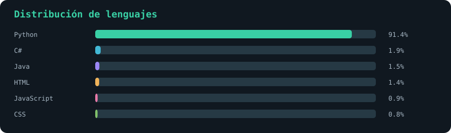
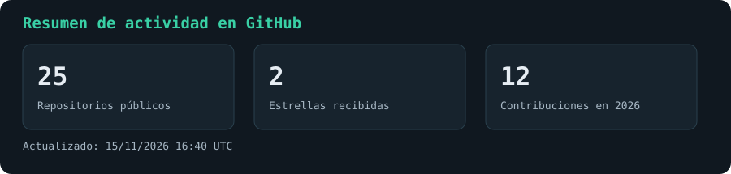
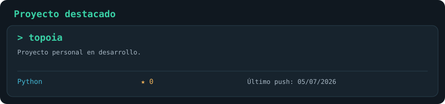
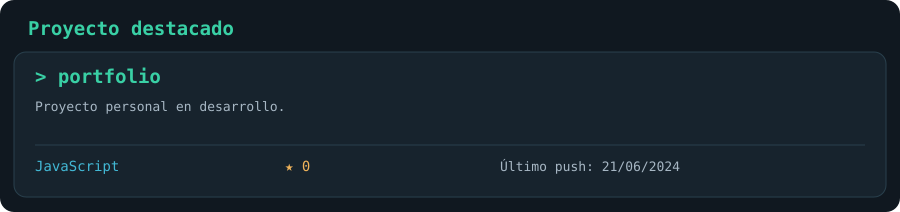
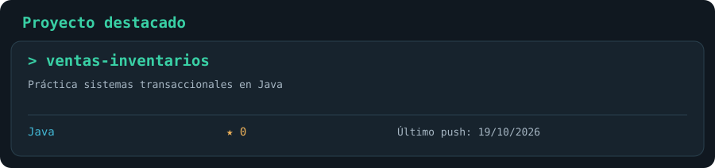
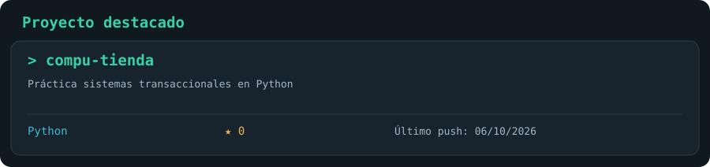
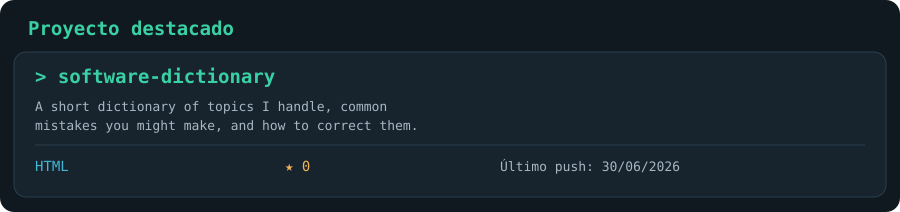
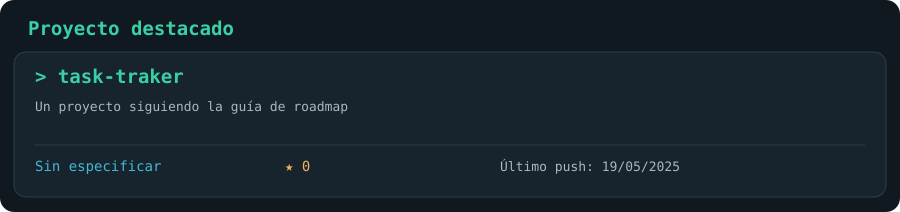
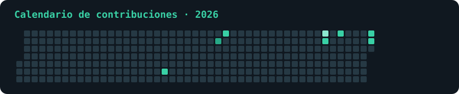

# Santiago González

### Desarrollador de Software Full Stack

`123santiagogonzalwz1@github:~$`

**Desarrollo web · Arquitectura de Software · Automatización**

---

## Sobre mí

Soy desarrollador de software, enfocado en crear aplicaciones funcionales, eficientes y mantenibles.

Me interesa el desarrollo Full Stack, la arquitectura de sistemas, las bases de datos y el aprendizaje continuo de nuevas tecnologías.

- **Enfoque:** desarrollo web y soluciones empresariales.
- **Lenguajes:** Python, C#, JavaScript y Java.
- **Actualmente:** fortaleciendo mis conocimientos en desarrollo de software.
- **Objetivo:** construir soluciones escalables y de calidad.

---

## Lenguajes de Programación

`123santiagogonzalwz1@github:~$ consultar-lenguajes`

<!-- LENGUAJES:INICIO -->

<!-- LENGUAJES:FIN -->

---

## Estadísticas de GitHub

`123santiagogonzalwz1@github:~$ consultar-estadisticas`

<!-- ESTADISTICAS:INICIO -->

<!-- ESTADISTICAS:FIN -->

---

## Proyectos destacados

Estos son algunos de mis proyectos personales y de aprendizaje

<!-- PROYECTOS:INICIO -->
<table width="100%">
<tr>
<td width="50%" align="center" valign="top"></td>
<td width="50%" align="center" valign="top"></td>
</tr>
<tr>
<td width="50%" align="center" valign="top"></td>
<td width="50%" align="center" valign="top"></td>
</tr>
<tr>
<td width="50%" align="center" valign="top"></td>
<td width="50%" align="center" valign="top"></td>
</tr>
</table>
<!-- PROYECTOS:FIN -->

---

## Actividad y contribuciones

`123santiagogonzalwz1@github:~$ consultar-contribuciones`

<!-- CONTRIBUCIONES:INICIO -->

<!-- CONTRIBUCIONES:FIN -->

## Colaboremos

Si alguno de mis proyectos te resulta interesante, puede explorar su código, proponer mejoras, reportar problemas o contribuir directamente.

**_Siempre aprendiendo, siempre construyendo._**

[Explorar mis repositorios](https://github.com/123santiagogonzalwz1?tab=repositories)

